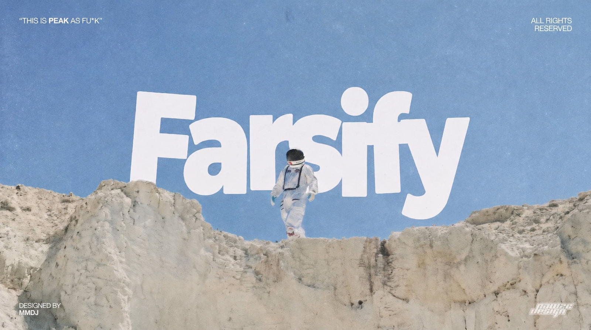
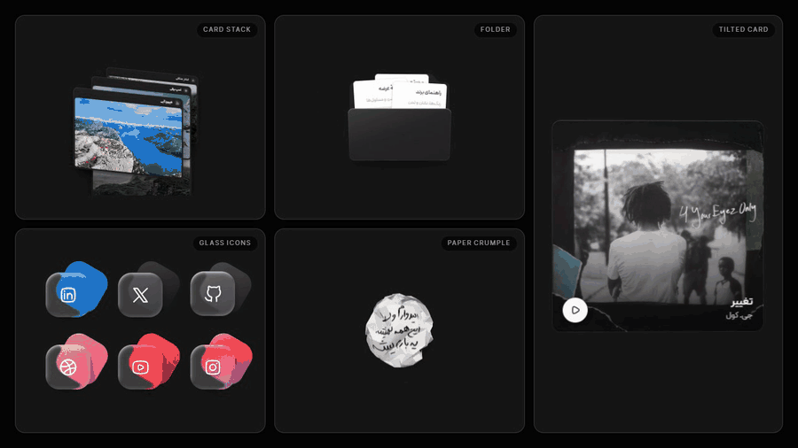
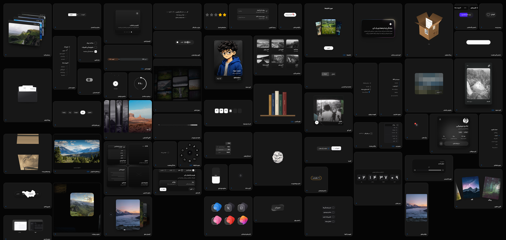

<div align="center">



# Farsify

**64 components** for Persian, right-to-left React interfaces.

Every one is a single file you copy into your project and own from then on.
No package to install, no build step, no link back to this site.

[](LICENSE.md)
[](components/README.md)
[](https://react.dev)
[](https://farsifyui.ir)

[Live previews](https://farsifyui.ir) · [Component index](components/README.md) · [Contributing](CONTRIBUTING.md) · [License](LICENSE.md)

</div>



## What's included

<div align="center">

| Category | ID | Count | Examples |
| --- | --- | --- | --- |
| Inputs | `inputs` | 12 | `squish-switch`, `wake-slider`, `theme-selector`, `comet-dial` |
| Buttons | `actions` | 13 | `magnet`, `hold-button`, `slide-commit`, `voice-pill` |
| Navigation | `navigation` | 10 | `gooey-nav`, `branched-menu`, `rail-toc`, `carousel` |
| Loaders & status | `status` | 4 | `lattice-loader`, `status-mark`, `thought-line`, `refine-frame` |
| Showcase | `showcase` | 25 | `card-swap`, `glass-icons`, `tilted-card`, `paper-crumple` |

</div>

Each component has a folder in [`components/`](components/README.md) with its code and a short guide, plus a page on the site with live controls. The full list is in the [component index](components/README.md).



## Why these components

- **Right-to-left by default.** Layout, direction-aware icons and motion follow RTL. Nothing is flipped or mirrored afterwards.
- **Persian typography that holds up.** No positive letter-spacing, no faded color on connected letters, line heights that leave room for descenders. These are the details that quietly break Persian text.
- **One file per component.** Helper functions are inlined, so the file you copy has everything it needs.
- **Nothing loaded from other domains.** No web font, image or script request at runtime.

## Install

Farsify is distributed as a shadcn registry. Add the namespace to `components.json` once:

```json
{
  "registries": {
    "@farsify": "https://farsifyui.ir/r/{name}.json"
  }
}
```

Then pull any component by name:

```bash
npx shadcn@latest add @farsify/magnet
```

**Prefer files?** Open `components/<slug>/` and copy `<slug>.tsx` into `components/farsify/`, plus `<slug>.css` if the component has one.

### Requirements

- React 19, tested with Next.js 15. Other React setups work as well.
- Tailwind CSS v4 and the standard shadcn theme tokens: `background`, `foreground`, `muted`, `accent`, `card`, `border`, `primary`, `ring`. Any project created with `npx shadcn init` already has them.
- Components that need CSS bring their own prefixed variables. None of them refer to the Farsify site.

> **Demo images:** a few components (galleries, photo cards) need pictures. The site uses its own photos; this repository ships none. Each affected component's README lists the default paths, so you can point them at your own images or pass them in as props.

## Repository layout

```
components/
  README.md            index, grouped by category
  <slug>/
    <slug>.tsx         component source (single file, no internal comments)
    <slug>.css         only when the component needs CSS
    meta.json          machine-readable metadata: category, props, dependencies, tips
    README.md          install command, usage example, props table
translations/en/       English copy used to generate the pages above
assets/readme/         images used by this file
```

The site repository is the source of truth, and this repository is generated from it. What you see here is exactly what `shadcn add` gives you. Documentation is in English; the live site is in Persian.

## Contributing

New components, fixes and bug reports are all welcome. Read [`CONTRIBUTING.md`](CONTRIBUTING.md) before you start, and use the [component request](https://github.com/mmdju/farsify/issues/new?template=component_request.yml) template to propose something new.

## License

[Farsify Components License (FCL) v1.0](LICENSE.md). Free for personal, educational and commercial use. You can build and sell products with the components, closed-source or not, without attribution. Selling or redistributing the components themselves — alone, as a kit, or through a marketplace — is not allowed. The Farsify name and logo are not covered by the license.
